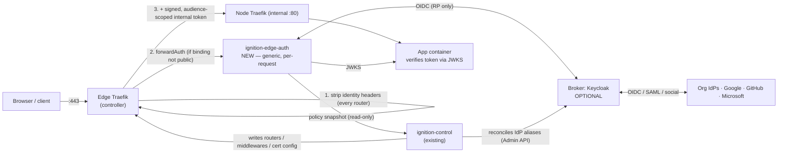

# Ignition roadmap — from hackathon platform to federated, multi-org edge

Status: **proposal — Phase 0 for the identity capability, plus a re-sequencing of
the existing "Likely next tasks".** No code changes. Written against `main` at
`dfe360c`. Everything under "Operational model today" and "Findings" was read
from the repo (docs and code); anything I could not confirm is listed under
[What I did not verify](#what-i-did-not-verify).

This document does three things:

1. Describes the **operational model** Ignition actually has — who runs what,
   what is long-lived vs. short-lived, where state and secrets sit — because
   every identity decision below is constrained by it.
2. Merges the **federated identity / org SSO / visibility brief** into that
   model: the smallest extension, the component choices, the data model, the
   trust boundary.
3. Produces one **sequenced roadmap** that interleaves identity with the work
   already queued in `CLAUDE.md` (tasks 3, 4, 6–9), because most of it is on the
   critical path of identity, not beside it.

It is the Phase 0 deliverable. **No implementation starts until the decisions in
[Decisions needed](#decisions-needed-before-phase-1) are made.**

---

## 1. Operational model today

### 1.1 What the platform is

One Spring Boot service, `ignition-control`, on one **controller**; a pool of
**nodes** it drives over the `docker` CLI. A **zone** is one team's isolated
stack (Forgejo + DinD + runner), assigned 1:1 to a node, torn down with
`compose -p zone-<slug> down -v`. Apps are separate compose projects
(`app-<slug>-<name>[-dev]`) on the zone's node, behind a per-node Traefik.
Persistence is PostgreSQL (Flyway V1–V7); secrets in `zone_secret` are AES-GCM
under `IGN_SECRET_KEY`; the work dir is ephemeral and re-rendered from the DB.

### 1.2 The lifecycle it is built around

| Phase | Who | What happens | Duration |
|---|---|---|---|
| Stand-up | operator | controller + core stack up; `/setup` with a log-printed code mints the first platform admin; register nodes | once per event |
| Onboard | platform admin | Provision zones one at a time or by **Roster** (slug list); first zone admin = the creator; invite leads by email | minutes for ~80 zones |
| Run | team members | issues → PR → release buttons → tag → CI → `POST /deploy` (per-zone `deploy-token`); `dev` by button; PR previews by label | hours–days |
| Reclaim | `IdleSweeper` | zone idle past `ignition.sweep.ttl` (24 h) is destroyed with every app | continuous |
| Teardown | platform admin | destroy zone / roster teardown | minutes |

Consequences that matter for identity:

- **Zones are ephemeral; people are not.** A judge, contractor or employee
  outlives any one zone. The identity model must hang people and
  organisations off something that survives zone destruction — today nothing
  does (zone *is* the team, `zone_member` cascades on zone delete).
- **Onboarding is bulk.** Roster takes slugs only. Any identity onboarding that
  needs one human click per person per zone will not scale to 80 teams; it has to
  ride on the roster.
- **The controller is a concentrated blast radius** (docker socket to every
  node, every zone token, `IGN_SECRET_KEY`, SMTP). Putting the identity signing
  key and every IdP client secret in that same process makes it worse. This
  drives the decision to make the edge-auth component a **separate process** (§4.2).
- **Single controller, single DB.** No HA story exists. An auth component in the
  request path of *every* browser request makes controller availability
  user-visible for apps too; the design needs an explicit stale-cache and
  fail-closed policy (§6.4).

### 1.3 Roles today

`PLATFORM_ADMIN` (global flag on `app_user`, implicitly zone admin of every
zone), `ZONE_ADMIN:<slug>`, `MEMBER:<slug>` (`ZoneMember.Role { MEMBER,
ZONE_ADMIN }`), plus a non-human `DEPLOY` role for CI. Authorities are the union
across zones. Access to `/teams/{slug}/**` is checked by
`ZoneAuthorizationManager`; everything else falls to `PLATFORM_ADMIN`.

### 1.4 Ingress: documented target vs. what runs

The documented target (`docs/exposure.md`, `CLAUDE.md` task 4) is: controller is
the only front door, owns `:443`/ACME, runs the edge Traefik and SSO gateway,
and routes by `Host` over WireGuard to **internal-only** node Traefiks.

What the code does today: `AppComposeBuilder` stamps per-app routers as Docker
labels with `entrypoints=websecure` and `tls=true` for the **node's** Traefik;
`TraefikDynamicConfig` writes exactly one file (`_platform.yml`, apex → control
plane); `traefik-core-compose.yml` still describes a node that owns `:80/:443`
and ACME. **The edge, WireGuard, edge wildcard certs and per-zone edge routers
are not built.** `docs/exposure.md` and `operating-an-event.md` both say so.

This is the single most important finding for the roadmap: **identity cannot be
enforced "at the edge" until there is an edge.** The edge is a phase of this
roadmap, not an assumption (Phase E).

---

## 2. Findings that change the plan

Each of these is verified in the repo and each maps to a roadmap item.

| # | Finding | Evidence | Consequence |
|---|---|---|---|
| F1 | **No org above zone; zone is the team.** | `AUTH-DESIGN.md`: "No team layer — a zone is the team"; `zone_member` PK `(zone_slug, user_id)` | The brief's Org → Zone → App → Team needs a new top level *and* a decision on what "team" means when zone is already the team (§5.1) |
| F2 | **Three overlapping visibility vocabularies**: per-zone `PUBLIC`/`PRIVATE` (AUTH-DESIGN, `Zone.Visibility`), per-app `corp`/`public`/`private` (`docs/exposure.md`, task 4), and the brief's five levels | `Zone.java:17`; exposure.md | Must be unified into one model or they will contradict. Brief's five levels supersede both (§7.1) |
| F3 | **Zone visibility is a column with no enforcement.** `/authz/zone/{slug}`, `forwardAuth` emission and the cookie `Domain=.<BASE_DOMAIN>` (AUTH-DESIGN step 7) do not exist | no `AuthzController`; `TraefikDynamicConfig` writes only `_platform.yml` | Completing step 7 is the natural first proof of the edge-auth mechanism (Phase I2) |
| F4 | **Release and deploy-from-main have no role check.** Only 5 `requireZoneAdmin()` calls in `ZoneConsoleController`, none on release/deploy | `ENVIRONMENTS-DESIGN.md`; `grep` count | Any member ships to production today. Independent bug; fix first (Phase H) |
| F5 | **`app_user.email` is `citext unique not null`** and the login key | `V2__identity.sql` | Violates "email is never an identifier" for federated users. Needs relaxing (partial unique index for local-credential users only) |
| F6 | **`zone_viewer` is an email allow-list** | `V2__identity.sql` | Same concept as a collaborator approval but weaker (email-keyed forever). Migrate into the approval model; do not run both |
| F7 | **Platform admin is implicitly zone admin everywhere.** | `AuthorityService`/ENVIRONMENTS-DESIGN | In a multi-org instance this means the operator reads every org's apps. Needs an explicit decision (D6) |
| F8 | **`traefik-public` is one flat network per node** | `CLAUDE.md` known gaps | Any container on a node can reach any app container by IP and can forge identity headers. **Therefore headers can never be trusted by backends; only signature verification can** — this is why the brief's trust rule is not optional here |
| F9 | **`dev` and PR-preview hosts are public by design**; `.apps.` is public today | CLAUDE.md decisions, task 6/7 | Under identity, generated URIs default to the *narrowest* level. That is a deliberate behaviour change and must be gated behind "identity enabled" so nothing changes for deployments that do not opt in |
| F10 | **The documented "bypass Basic-auth / git user-agent" rule is spoofable** if applied broadly | `docs/exposure.md` | Must be scoped to the `git.<slug>` router and Forgejo/registry path prefixes, never to app routers, or a header is a universal SSO bypass (§6.3) |
| F11 | **Backend TLS is already designed** as "Ignition as its own CA" (NODE-BACKENDS-DESIGN) | that doc | Reuse for the edge→node hop; do not invent a second mechanism for the trust boundary |
| F12 | **Test baseline is thin**: 6 test classes, one Spring context test; Testcontainers is on the classpath; no coverage/format plugin found in `pom.xml`; CI is `image.yml` + `pages.yml` only | `pom.xml`, `.github/workflows` | "Meet existing quality gates" is nearly vacuous today. Phase H adds a real test harness; the invariant suite needs it |

---

## 3. Principles for this roadmap

Taken from the brief, restated in this repo's terms.

1. **Additive and optional.** `ignition.identity.enabled=false` (default) =
   today's behaviour, byte for byte: no Keycloak, no edge-auth container, no new
   required config. Migrations create a single implicit **default org** so the
   schema is the same either way.
2. **Traefik stays the gateway.** Routing, discovery and ACME are unchanged; the
   edge Traefik gains middlewares, nothing more.
3. **No identity-provider or protocol code in Ignition.** An established broker
   (Keycloak) speaks OIDC/SAML to upstreams. Ignition speaks only OIDC
   *relying-party* to the broker, via Spring Security's `oauth2-client`
   (configuration of an established library, not hand-rolled protocol) — D3
   asks you to confirm that reading of the rule.
4. **Authentication ≠ authorization; platform ≠ application.** The platform
   answers "may this identity reach *this app* with *these scopes*"; the app
   answers everything finer.
5. **Control plane ≠ data plane.** Seeing/managing an app in the console is a
   different grant from reaching its URL.
6. **Server-side enforcement only.** The login page showing the right IdPs is
   UX; the control is the edge-auth component checking the allow-list when it
   mints the token.

---

## 4. Target architecture

### 4.1 The smallest extension

One new deployable, one new optional broker, one new schema area. Nothing
existing is rewritten.



What is **new**: `ignition-edge-auth`, the broker adapter, `org*`/`idp*`/
`approval`/`binding`/`team` tables, edge router + middleware generation in
`TraefikDynamicConfig`.

What is **unchanged**: node placement, provisioning, compose transform,
Forgejo, DinD, releases, Watchtower, the deploy-token CI bridge, node Traefik
(only its entrypoint/TLS role changes in Phase E, which is already planned).

### 4.2 Responsibility table

| Concern | Ignition (`ignition-control`) | Edge Traefik | `ignition-edge-auth` | Broker (Keycloak) | Application |
|---|---|---|---|---|---|
| Routes, hostnames, certs/ACME | **generates** config | **executes** | – | – | – |
| Strip inbound identity headers | decides (always on) | **executes** | – | – | – |
| Login UI per org; IdP selection | org/IdP registry, branding data | – | renders org-scoped login, binds org to the login transaction | hosts per-IdP login/redirects | – |
| OIDC/SAML to upstream IdPs | configures aliases via adapter | – | – | **does it** | never |
| Session, `idp`/`amr`, allow-list enforcement | holds the policy | – | **enforces at mint time** | – | – |
| Internal token mint / JWKS | – | – | **mints, publishes** | – | verifies |
| Org/zone/app/team/binding model | **source of truth** | – | consumes snapshot | – | – |
| Visibility enforcement | computes effective level (ceilings) | forwards to auth | **evaluates per request** | – | – |
| Console/catalogue listing | **filters by role** | – | – | – | – |
| Domain-application decisions ("owns account 12345") | – | – | – | – | **only here** |
| Audit | writes control-plane events | access log | writes auth events | its own events (not trusted as audit) | its own |

### 4.3 Why a separate `ignition-edge-auth` process

- It holds the **signing key** and the **broker client secret**; it does *not*
  need the docker socket, `IGN_SECRET_KEY`, zone tokens or SMTP. Keeping those
  out of the process in the hot path of every request shrinks the blast radius
  that §1.2 already flags.
- It can be restarted/scaled independently and deployed only when identity is
  enabled (principle 1).
- Cost: a policy-sync contract. Mitigated by a **versioned read-only snapshot**
  served by `ignition-control` on `ignition-internal` (bearer + network-scoped),
  cached in memory, refreshed on a push notification with a poll fallback.

New Maven module `ignition-edge-auth` (own image), sharing only a small
`ignition-policy` library (claim names, policy evaluator, snapshot DTOs) with
`ignition-control` so the evaluator is one implementation tested once.

### 4.4 ForwardAuth component choice

Requirements that decide it: per-request **org/zone/app/binding resolution by
`Host`**; per-org IdP allow-list enforced at mint time; two membership classes;
visibility ceilings; **re-minting a signed token per target audience**;
non-disclosing 404/403; revocation by session/user/(org, IdP).

| Option | Fit | Why / why not |
|---|---|---|
| **oauth2-proxy** | Poor | Single static provider per instance; no org concept; cannot bind an org to the login transaction; cannot mint per-audience tokens (it forwards the IdP's own token/claims, which is the "broker token leaks to backend" outcome the brief forbids); authorization is group/email lists, not our model. Could be chained in front, but then Ignition still needs the second component — net cost higher |
| **Authelia** | Poor | Own user store/portal and ACL model; per-domain rules not our org/class/ceiling model; no audience-scoped signed token |
| **Pomerium / Ory Oathkeeper / Traefik OIDC plugins** | Poor–medium | Closer in spirit (policy per route) but each still lacks one or more of: org-bound login transaction, class-aware allow-list, per-audience mint; plugins run inside Traefik's sandbox and are not multi-tenant |
| **Purpose-built, small, generic service** (Spring Boot) | **Best** | Everything above is *our* policy, expressed once; protocol work is delegated to Spring Security's `oauth2-client` against the broker; no per-application code |

**Recommendation:** purpose-built `ignition-edge-auth`, ~one controller
surface (`/authz`, `/login/*`, `/callback`, `/logout`, `/.well-known/jwks.json`),
Spring Security OIDC client. Revisit only if the Phase I2 spike shows the
Traefik↔Spring session handoff cannot meet the cookie requirements.

### 4.5 Broker and the abstraction

`BrokerAdapter` (interface) in `ignition-control`: `upsertIdp(IdpSpec)`,
`removeIdp(alias)`, `terminateSessions(filter)`, `discoveryHint(org)`. Default
`KeycloakBrokerAdapter` (Admin REST API). Provider-specific differences
(Entra tenant endpoints, Google `hd`, SAML attribute mapping) live **only**
inside the adapter and `IdpSpec` kinds — never in policy or tokens.

### 4.6 Broker mapping recommendation

| Option | Isolation | Ops cost at N orgs | Per-org branding | Secret/key separation | Allow-list enforcement |
|---|---|---|---|---|---|
| Realm per org | strongest | high — N realms, N admin credentials, N client registrations, slow startup past low hundreds | native | native | broker + Ignition |
| Single realm + Keycloak **Organizations** | medium | low | partial | shared realm keys | split between broker feature and Ignition |
| **Single realm, per-org IdP aliases, policy in Ignition** | logical (our code) | **lowest** | via login theme keyed by org, rendered by edge-auth | per-IdP client secrets in Ignition's cipher; one realm key set | **entirely Ignition's** |

**Recommend the third.** Reasons grounded in the invariants: the allow-list
must be enforced *by us* at mint time regardless of what the broker is
configured to do (invariants 1–2), so isolating in the broker buys little; the
platform must be able to swap brokers (brief), which a realm-per-org or
Organizations-native design would couple us to; and N is orgs, not teams, so a
single realm is comfortably in range. Cost accepted: one broker misconfiguration
could cross orgs — hence the allow-list is re-checked in edge-auth, the realm's
first-broker-login flow is locked down (no automatic linking by email, "trust
email" off), and the invariant tests run against the real broker (Phase I3+).

Spike (Phase I3): confirm Keycloak can emit the **upstream** `(issuer,
subject)` — via the `identity_provider` / `identity_provider_identity` user
session notes through a protocol mapper — because Keycloak's own `sub` is a
Keycloak user id. If it cannot, the adapter fetches `federated_identity` per
login; this is a correctness issue, not an optimisation.

---

## 5. Tenancy model

### 5.1 Org → Zone → Application → Team, mapped to what exists

```
Org            NEW      persistent tenant; owns IdPs, verified domains, policy, members
 └─ Zone       EXISTS   isolated infrastructure stack (Forgejo+DinD+runner) on one node;
 │                      gains org_id; slug stays globally unique (it is a hostname label)
 │   └─ App    EXISTS   zone_slug + name; web service of a compose project
 │        └─ Binding NEW   (host, level) pair: the generated URI(s) + any vanity hosts
 └─ Team       NEW      a group of members/collaborators scoped to a zone; assigned to apps
```

Decisions this forces (D1, D2):

- **Zone stays the infrastructure unit** (1:1 node, Forgejo org, quotas). The
  brief's "a zone may narrow provider allow-lists" is a policy *attribute*, not a
  reason to move infrastructure.
- **Team inside a zone.** Today zone = team, so for the hackathon case the
  zone's `zone_member` rows *are* the team. Recommendation: introduce `team`
  but give every zone an implicit **default team** containing all its members,
  so existing behaviour is unchanged and per-app team assignment is opt-in
  (Phase I6). Do not force teams on hackathon zones.
- **Migration:** create org `default`; every existing zone gets
  `org_id = default`. Identity-disabled deployments only ever see the one org.

### 5.2 Request → (org, zone, app, binding) resolution — before login

Resolution is by **`Host`**, computed from DB, never from client-supplied
claims. `ignition-control` publishes it in the snapshot as an exact-match map.

| Host pattern | Resolves to |
|---|---|
| `<BASE_DOMAIN>` | instance console (platform + any org's console view by role) |
| `git.<slug>.<BASE_DOMAIN>` | zone `<slug>` → org; Forgejo (git/registry bypass rules, F10) |
| `<app>.apps.<slug>.<BASE_DOMAIN>` | zone → org; app `<app>`; generated binding |
| `<app>.dev.<slug>.<BASE_DOMAIN>` | same; `dev` binding |
| `<app>-pr-<n>.apps.<slug>…` | preview binding of source app |
| any verified vanity host | its binding → app → zone → org |

Unknown host ⇒ same response as "exists but denied" (§7.3). The resolved org is
written into the login transaction (state + nonce + `org_id` + IdP alias) so the
callback is valid only for that org's IdP instance.

### 5.3 Roles (initial set)

| Scope | Roles | Notes |
|---|---|---|
| Instance | `platform_admin` | infra + instance IdP catalogue + org-creation policy; **no implicit data-plane access** (D6) |
| Org | `org_owner`, `org_admin` | org policy, IdPs, domains, approvals; only own org |
| Zone | `zone_admin` | maps to today's `ZONE_ADMIN`; may narrow, never widen, org policy |
| Team/app | `owner`, `developer`, `viewer` | today's `MEMBER` ≈ `developer`; release/promote gates from ENVIRONMENTS-DESIGN attach here |
| Class (orthogonal) | `member`, `collaborator` | set by *how admitted*, carried in `member_type` |

The `ZONE_ADMIN:<slug>`/`MEMBER:<slug>` authorities stay valid; new roles are
added alongside, so `SecurityConfig` and `ZoneAuthorizationManager` keep working.

---

## 6. Identity design

### 6.1 Internal token (final claim set, proposed)

JWS, **ES256**, header `kid`. Delivered in a dedicated header
`Ignition-Identity` (leaves `Authorization` free for the app's own use).

| Claim | Meaning |
|---|---|
| `iss` | edge-auth issuer URL |
| `sub` | Ignition user id (`app_user.id`) — **stable**. `user_id` is *not* duplicated; the brief lists both, D4 confirms dropping the duplicate |
| `aud` | the target app audience (one token per audience; never reusable across apps) |
| `exp`, `iat`, `nbf` | `exp − iat ≤ 60 s` (minted per request, so no refresh logic in apps); skew tolerance 30 s |
| `jti`, `sid` | token id; session id (revocation and audit join key) |
| `org_id`, `zone_id` | resolved tenancy |
| `member_type` | `member` \| `collaborator` |
| `roles`, `scopes` | org/zone/team roles; granted scopes after the **collaborator ceiling** is applied |
| `teams` | team ids (small list; token stays well under header limits) |
| `idp`, `amr` | IdP instance id (opaque to apps; never a provider name) and authentication methods |

Apps verify issuer + signature (JWKS) + audience + expiry and consume claims.
They never see a broker token and never learn "Google/Entra/SAML".

### 6.2 Keys and secrets

- **Signing keys:** generated by edge-auth, stored encrypted in the `edge`
  schema under a key from a Docker secret (`IGN_EDGE_KEY`) — *not* under
  `IGN_SECRET_KEY`, so the control plane cannot sign tokens. Rotation:
  new key published in JWKS first, signing switches after ≥ one token lifetime
  + max cache TTL, old key stays in JWKS for the same overlap, then retires.
  Scheduled (default 30 d) and on demand.
- **IdP client secrets:** new `org_idp_secret`, encrypted by the existing
  `SecretCipher` pattern, never rendered into generated files; the adapter pushes
  them to the broker at reconcile time. Secrets are write-only in the console.
- **Backup/DR:** `pg_dump` + `IGN_SECRET_KEY` (existing) + `IGN_EDGE_KEY` (new).
  Loss of the edge key = all sessions invalid + a new key; acceptable and
  documented. Loss of `IGN_SECRET_KEY` now also costs IdP secrets (org admins
  re-enter them) — document explicitly, it is a larger consequence than today's
  "re-provision zones".

### 6.3 Trust boundary

1. **Edge Traefik strips every identity header on every router** — through an
   *entrypoint-level* default middleware, so routers Ignition did not write, public
   routers and `security.enabled: false` routers are all covered. It is not a
   per-router option and cannot be forgotten.
2. After strip, only `forwardAuth` response headers may set identity, and only
   for non-public bindings whose auth returned 2xx. (Traefik also removes an
   inbound header named in `authResponseHeaders` before copying — a second layer;
   verified by test, not assumed.)
3. **Backends trust nothing but the signature.** The hop edge → node Traefik →
   container is plain HTTP over WireGuard today (F8: flat `traefik-public`, so
   co-tenant containers can forge headers). Protection is therefore: (a)
   WireGuard + a node firewall that only admits the controller's tunnel address
   to node Traefik, (b) **signature + audience verification in the app**, (c)
   when it lands, edge→node mTLS from the Ignition-CA design (F11). Limits:
   an app that skips verification is trusting the network, and on a flat
   network that means trusting other teams' containers — documented loudly, and
   the deploy scaffold ships a verifier snippet.
4. **git/docker bypass (F10):** Basic-auth / git-UA bypass exists **only** on the
   `git.<slug>` router and on Forgejo/registry path prefixes, where Forgejo itself
   authenticates with a PAT. It is never attached to app routers. Bypassed
   requests still have identity headers stripped.
5. **Public bindings** receive no identity unless the route is marked
   *optional-auth*, in which case edge-auth attaches a token only for an already
   valid session.

### 6.4 Sessions, revocation, delays (stated, not hoped)

- Cookie: `Secure; HttpOnly; SameSite=Lax; Domain=.<BASE_DOMAIN>` for first-party
  hosts; **vanity hosts cannot share that cookie**, so each vanity host runs its
  own login handshake (one-time code redirect from the apex session) — noted in
  Phase I7. CSRF on every state-changing edge-auth endpoint; exact-match
  redirect URI validation against registered hosts only.
- **Policy propagation** (allow-list change, revoked approval/membership, removed
  team member): ignition-control bumps a policy epoch and notifies edge-auth;
  fallback poll every 15 s. Effective delay **≤ 15 s** typical; a backend that
  already accepted a token keeps access for at most the token `exp` (**≤ 60 s**
  more). Edge-auth tolerates control-plane downtime on cached policy for
  `max-stale` (default 10 min) then **fails closed for everything not public**.
- **Member deprovisioning at the org's IdP** cannot be seen push-style (no SCIM
  in scope). Bound by `member-revalidate-interval` (default 15 min, silent
  re-auth/refresh against the IdP) and an absolute session max age (default 8 h).
  **State this in the docs as the member-deprovisioning delay.** Collaborators
  are immediate on revoke/expiry.
- Logout: edge-auth session + broker session (RP-initiated logout) + local
  `sid` revocation; back-channel logout from the broker honoured.

### 6.5 Org policy and classes

Per org: `member_mode ∈ {optional, preferred, required}` over an explicit
allow-list of IdP instances for `member`, and a **separate** allow-list +
scope ceiling for `collaborator`. A zone may only intersect (narrow) these.
Class derives from the admitting path (SSO IdP ⇒ `member`; approval ⇒
`collaborator`), never from claims. A person with both has two memberships and
two sessions. Org admins write only their own org (row-level checks in the
service layer, plus tests that enumerate every org-scoped endpoint with a
foreign org id).

### 6.6 External identities and linking

`external_identity(issuer, subject)` unique; Entra keyed by tenant-specific
issuer + `tid` + `oid`, **validated on every login against the configured
tenant**, never `common`/`organizations`. Email and `preferred_username` are
display data only. Linking: explicit, from an authenticated session, with recent
re-auth of both identities; never automatic by email. A collaborator approval
whose address falls in an org's verified SSO domain is rejected at creation
(and flagged if a domain is verified later).

### 6.7 Approvals (open auth) and self-service orgs

Approval = exact full address + allowed IdP instance(s) + role set + optional
expiry + approver. **Default expiry 30 days, configurable per org** (D8).
Activation requires a verified-email assertion from a *trusted-to-verify* IdP
(Google yes; GitHub/Facebook no) or possession of an invitation token; then it
binds to `(issuer, subject)`, is single-use, and from then on email is
irrelevant. Failures return the same response as any denial (no enumeration
oracle). Org creation: platform policy `who_may_create ∈ {platform_admin_only,
allow_listed_domains, any_authenticated}` with per-user and per-instance quotas
and rate limits. Approvers: org owner/admin; delegation to members is a later,
explicit toggle.

---

## 7. Visibility, ceilings, vanity domains

### 7.1 One vocabulary

Levels, narrowest first: `team` → `zone` → `org` → `authenticated` → `public`.
This **supersedes** both Zone `PUBLIC/PRIVATE` and app `corp/public/private`:

| Old | New |
|---|---|
| Zone `PUBLIC` | zone ceiling `public` (default when identity is **off**) |
| Zone `PRIVATE` | zone ceiling `zone` + `zone_viewer` rows → approvals |
| App `corp` | `org` |
| App `public` | `public` |
| App `private` (+CIDR) | not a visibility level; an orthogonal `ip_allowlist` attribute on the binding |

Ceilings apply top-down, narrowest wins: instance → org → zone → binding's own
declaration. `public` always needs an explicit declaration and may require
zone-admin approval. Generated URIs default to `team`.

**Behaviour change guard:** with identity disabled nothing is evaluated and all
existing hosts remain public. Turning identity on is the moment defaults
tighten; the enablement checklist (Phase I2) lists every existing public host
and offers a one-shot "declare current exposure explicitly" so an operator
decides, rather than discovers.

### 7.2 Declarative schema (proposed)

Authored in the app's repo, fetched at the deploy `ref` like `compose.yaml` and
`.env` — a new `ignition.yaml` (or a labelled block in `compose.yaml`; D5) —
parsed in `AppComposeBuilder`'s trust boundary, **validated against the ceilings
at deploy time and rejected, never silently clamped**:

```yaml
security:
  enabled: true                       # false => public (needs ceiling to allow it)
  authentication: { required: true }
  authorization:
    scopes: [accounts:read]
    allowedMemberTypes: [member, collaborator]
  identity: { audience: accounts-api }
  visibility:
    generated: team                   # default; most restrictive
    bindings:
      - host: shop.acme.example
        level: public
```

Routes mixing public and protected are expressed as extra bindings with a path
prefix only once the compose/router model supports it (today one router per
host); not in v1.

### 7.3 Non-disclosure

Unauthenticated to a non-public binding → login for the resolved org/zone.
Authenticated without access → 404 or 403 per policy, **identical body/headers/
timing shape to a non-existent host**. Console and API list only apps/zones
where the caller holds a role (control-plane filter, tested by enumeration).

### 7.4 Vanity domains and takeover

- Ownership by DNS challenge (TXT); host unique across the **whole instance**
  (unique index, checked case-folded/punycode-normalised).
- ACME and routing unchanged; the edge adds a cert resolver entry per verified
  host.
- **Lifecycle** (this is where the ephemeral-zone model bites — §1.2): when an
  app, zone or org is removed, its bindings move to `QUARANTINED`: router
  removed (edge returns the standard unknown-host response), cert retained
  until natural expiry, domain claim **reserved by the org for 30 days**, then
  released. `IdleSweeper`, `ZoneService.destroy` and org delete must all call one
  `BindingService.retire()`; a test fails if any destroy path skips it.
- Vanity cookies: per-host handshake (§6.4).

---

## 8. Data model (PostgreSQL, Flyway V8+)

Additive; existing tables only gain nullable/defaulted columns.

```
org(id, slug, name, status, created_by, created_at)
org_policy(org_id, member_mode, collaborator_enabled, collab_scope_ceiling[],
           default_approval_ttl, public_allowed, public_needs_zone_admin)
zone  + org_id (default org), + visibility_ceiling
idp_catalogue(id, kind, display, trusted_to_verify_email, shared_client_ref)   -- instance level
idp(id, alias, kind, owner_org_id NULL=shared, issuer, tenant_id, client_id,
    secret_ref, metadata_ref, status)       -- UNIQUE(issuer,tenant_id) unless platform-approved
org_idp_allow(org_id, idp_id, member_class)  -- the allow-list; zone-level narrowing in zone_idp_allow
verified_domain(domain UNIQUE, org_id, purpose[sso|vanity], status, challenge, verified_at)
app_user  (existing id stays the Ignition user id; email → nullable contact; local-login
           uniqueness becomes a partial index)
external_identity(user_id, issuer, subject, idp_id, linked_at)  UNIQUE(issuer,subject)
org_membership(org_id, user_id, member_type, roles[], source, status, expires_at,
               bound_issuer, bound_subject)
approval(id, org_id, address_exact, idp_ids[], roles[], expires_at, status,
         invited_by, activated_membership_id, token_hash)
team(id, zone_slug, name) · team_member(team_id, membership_id, role) · app_team(zone_slug, app, team_id)
binding(host UNIQUE, zone_slug, app, kind[generated|vanity|dev|preview], level,
        ip_allowlist, state[ACTIVE|QUARANTINED], domain_ref)
audit_event(id, at, actor, org_id, action, subject, outcome, request_id, detail)  -- append-only
-- edge schema (owned by ignition-edge-auth, separate DB role):
edge.session(sid, user_id, org_id, membership_id, idp_id, amr, created, last_seen, revoked_at)
edge.signing_key(kid, alg, key_enc, state, not_before, retire_at)
```

`state/audit.log` from DESIGN.md never materialised in code I read; the audit
table is the first real audit sink and is also what the console's activity page
will read.

---

## 9. Roadmap

Legend: **[E]** = already on the roadmap in `CLAUDE.md`; **[I]** = identity;
**[H]** = hardening prerequisite. Each phase = one reviewable change set with
tests and docs, and each ends with the platform still working with identity
off.

### Phase H — Hardening and a test floor (no identity)

Independent, shippable now, and required before the invariant suite is credible.

- Add `requireZoneAdmin()`/role check to `release()` and deploy-from-main (F4);
  test that a plain member gets 403. *(Decide in D7 whether "member can release"
  was intentional for hackathons; if so make it an explicit zone setting, not an
  absence.)*
- Test harness: Testcontainers Postgres + `MockMvc`/`@SpringBootTest` slices for
  `SecurityConfig` matrix; JaCoCo with a baseline gate set at today's number and
  ratcheted; wire tests into CI (`image.yml` currently builds the image).
- Audit table + `AuditService` used by existing admin actions (user disable,
  role change, zone destroy).
- Exit: CI runs tests; coverage gate exists; F4 closed.

### Phase E — The edge (CLAUDE.md task 4, minus SSO) **[E]**

Prerequisite for everything below; useful on its own.

- Controller compose gains edge Traefik (`:443`, ACME DNS-01, wildcard apex cert),
  WireGuard peering written at node registration; node Traefik becomes
  internal-only `:80` (labels switch off `websecure/tls`, Backends reuse
  `TraefikDynamicConfig` for the edge side).
- `TraefikDynamicConfig` writes per-zone/app **edge routers** from DB rows
  (`binding`, with `kind=generated`), per-zone cert domains, and the
  **entrypoint-level identity-header strip** middleware — enabled even though
  identity is off, so the guarantee exists before it is needed.
- Node firewall rule/doc: node `:80` admits only the controller tunnel address.
- Exit: end-to-end deploy via the edge; `curl -H 'Ignition-Identity: x'` never
  reaches a backend; identity off ⇒ today's URLs, now through the edge.
- Verification bar (DESIGN.md step 9 precedent): real run against a live node.

### Phase I1 — Org layer and default org **[I]**

- Migrations: `org`, `org_policy`, `zone.org_id` (all → `default`), `binding`
  rows backfilled for every existing app/dev/preview host (`level=public`,
  mirroring today's behaviour), `app_user.email` relaxation (F5).
- `OrgService`, org-scoped repository access; console shows the org switcher
  only when more than one org exists.
- Exit: byte-identical behaviour with identity off; migration test from a V7
  database snapshot.

### Phase I2 — `ignition-edge-auth` + internal token, with *local* login **[I]**

First enforcement, **no broker yet**: edge-auth authenticates against the
existing Ignition accounts (the form login becomes edge-auth's first
"IdP" kind `local`). This delivers AUTH-DESIGN step 7 (private zones, F3) and
proves every non-broker mechanism cheaply.

- New module + image; snapshot API in ignition-control; policy epoch push/poll;
  `/authz`, cookie, JWKS, token mint (§6.1), key generation/rotation (§6.2).
- `ignition.identity.enabled` flag; compose profile so the container only exists
  when on; enablement checklist for existing public hosts (§7.1).
- Console accepts the internal token (resource-server filter, `aud=console`)
  alongside form login; **form login remains as break-glass platform admin** and
  is never subject to org IdP policy.
- Backend verifier snippet + sample protected app in the deploy scaffold.
- Tests: unauthenticated→login; authenticated→routed; unauthorized→denied;
  expired / wrong-aud / bad-signature→denied; spoofed headers stripped on
  protected **and** public; identity-off unchanged; `max-stale` fail-closed;
  key-rotation overlap.
- Exit: a private zone's `git.<slug>` and apps are gated by membership + viewer
  list; git/docker push via PAT works; public zone unchanged.

### Phase I3 — Broker, social login, external identities **[I]**

- `BrokerAdapter` + Keycloak adapter; realm bootstrap as code; locked-down
  first-broker-login flow; upstream `(issuer, subject)` spike resolved (§4.6).
- `idp_catalogue` + instance-level shared clients (Google, GitHub, Microsoft
  social, Facebook); `external_identity`; session registry; logout incl. broker.
- **Local dev:** one `docker compose up` — Ignition, edge Traefik, Keycloak with
  imported realm, sample protected app, and a local OIDC "corporate IdP"
  stand-in (a second Keycloak realm or a mock OIDC server), seeded orgs
  (`acme` SSO-required, `open` optional), users, roles, scopes. No external
  accounts needed; social is optional.
- Tests: social login end-to-end; callback bound to the transaction's IdP
  instance; forged callback via a different alias rejected.
- Exit: login via a catalogue IdP yields a verified token in the sample app.

### Phase I4 — Org SSO (OIDC), allow-lists, member class **[I]**

- Org-owned IdPs (OIDC first), org admin UI, `org_idp_allow`, `member_mode`
  semantics, mint-time allow-list check, session termination on policy change,
  verified domains + discovery hint, Entra tenant rules (§6.6), uniqueness of
  tenant/domain across orgs.
- Invariants **1, 2, 3** (and the member half of 6) as a named test class;
  Entra cases: two tenants, wrong `tid`/issuer, same email ⇒ distinct
  identities, social Microsoft never grants membership.
- Exit: SSO-required org cannot be bypassed by social, discovery, linking,
  renewal or email-claim spoofing — each its own failing-first test.

### Phase I5 — Collaborators, approvals, self-service orgs **[I]**

- `approval` lifecycle, activation rules, `(issuer, subject)` binding, no
  enumeration oracle, re-pointing as an audited admin action, SSO-domain
  rejection, scope ceiling, `allowedMemberTypes`.
- Migrate `zone_viewer` into approvals (F6) with a reversible migration.
- Org creation policy + quotas; owner bootstrap; audit events.
- Invariants **4, 5, 6**; lookalike-address, unverified-email, cross-org,
  address-change, dual-membership/no-elevation tests.

### Phase I6 — Teams, scoped roles, per-binding visibility **[I]** (+ ladders)

- `team`, default team backfill, app assignment; roles `owner/developer/viewer`.
- Visibility levels and ceilings in `binding`; `ignition.yaml` parsing with
  reject-on-exceed; console/API listing filtered by role; 404/403 non-disclosure.
- **ENVIRONMENTS-DESIGN [E]** lands here: environments become binding `kind`s;
  promotion gates use these roles (shape (1) from that doc first).
- Tests: team app unreachable by either URI; ceiling widening rejected;
  generated restricted while vanity public; removed team member loses access
  within the stated bound; no listing leaks.

### Phase I7 — Vanity domains and takeover handling **[I]**

DNS-challenge ownership, instance-unique claims, edge cert per host, per-host
login handshake, `BindingService.retire()` wired into every destroy path,
quarantine/reservation lifecycle. Test: destroy via sweeper, zone destroy, org
delete, app delete each quarantine; collision across orgs rejected.

### Phase I8 — SAML, remaining providers, linking **[I]**

Org SAML 2.0 (via broker), generic OIDC, Okta/Auth0/Google Workspace/Keycloak
presets; explicit account linking with dual re-auth; metadata refresh and cert
rollover alerts. SAML sequence diagram and troubleshooting.

### Phase I9 — Operability and docs completion **[I]**

Scheduled key rotation exercised in CI, revocation-delay SLO test against the
stated bounds, structured security events (never logging passwords, codes,
tokens, cookies, full internal tokens — enforced by a log-scrubbing test),
correlation ids from the edge, audit export, load test of the `/authz` hot path
(budget: p99 < 15 ms at 500 rps on controller hardware; to be validated, not
assumed). All required docs and the seven sequence diagrams (§11).

### Cross-cutting items on the existing roadmap, re-sequenced

| Existing item | Where it fits | Why |
|---|---|---|
| Task 4 — single front door | **Phase E**, SSO half = I2–I3 | gating dependency |
| Task 3 — services catalogue (shared/credentialed proxies) | after I2 | each catalogue service is just another *audience*; per-zone metering uses `zone_id` in the token. Do not build proxy-specific auth |
| Task 6 — `dev` follow-ups | `noindex`/gate resolved by I6 bindings; idle TTL independent | the "dev host gate" question is answered by `binding.level` |
| Task 7 — PR previews | bindings of `kind=preview`; default `team` | currently public (F9) |
| Task 8 — pluggable nodes | independent; must keep the `NodeBackend` seam free of routing assumptions | binding target becomes backend-specific; edge→node mTLS from the Ignition-CA design closes the §6.3 limit |
| Task 9 — environment ladders | I6 | needs scoped roles (F4) |
| Task 1 — DNS records / starter repo seeding | unaffected | wildcard DNS means zero DNS; seeding gains `ignition.yaml` + verifier snippet |
| Task 2 — quotas / `move` carrying volumes | unaffected | |
| Task 5 — per-team presentation | out of scope here | would be one more app with its own binding |

---

## 10. Test strategy (summary)

- **Unit:** policy evaluator (levels × ceilings × class × teams × binding),
  allow-list check, claim construction, approval state machine, domain
  normalisation. Pure; lives in `ignition-policy`.
- **Slice/integration:** Testcontainers Postgres + Spring slices for
  `SecurityConfig`, org-scoping (every org-scoped endpoint exercised with a
  foreign org id), migrations (V7 → V8+ upgrade from a snapshot).
- **Contract/e2e:** Testcontainers stack — Traefik + edge-auth + Keycloak + a
  representative backend that verifies the token. Runs the full invariant list.
  Slower; separate CI job, required on `main`.
- **Invariants 1–6 and the visibility list** each map to a named test in the
  phase that introduces the capability (see phases); none is "covered
  incidentally". A traceability table in `docs/identity/testing.md` maps brief →
  test names so gaps are visible.
- **Identity-off regression:** the existing e2e path (deploy through the edge)
  runs in CI with identity disabled on every phase.
- Gateway tests cover generic behaviour only; no app API tests duplicated.

---

## 11. Documentation plan

New `docs/identity/` (added to the mkdocs nav and versioned with `mike`, per the
existing docs pipeline): architecture, trust boundaries, login flows, internal
identity model, social login, org SSO, OIDC and SAML configuration, application
`security` config, local dev, production deployment, secrets, key rotation,
troubleshooting, member-deprovisioning delay, revocation bounds.
Mermaid sequence diagrams: (1) unauthenticated access, (2) social login,
(3) org OIDC SSO, (4) org SAML SSO, (5) authenticated API request,
(6) authorization failure, (7) logout. Existing pages updated: `exposure.md`
(per-app visibility replaced by §7.1), `roles.md`, `operating-an-event.md`,
`AUTH-DESIGN.md` (step 7 status), `CLAUDE.md` (decisions + task list).

---

## Decisions needed before Phase 1

| # | Decision | Recommendation |
|---|---|---|
| D1 | Is **zone = infrastructure unit** (org added above, team inside)? | Yes; implicit default team per zone so hackathons see no change |
| D2 | Do you want per-app team assignment at all in v1, or zone-wide membership only until Phase I6? | Defer teams to I6 |
| D3 | Is Spring Security's OIDC *client* (RP to Keycloak only) acceptable under "no protocol logic in Ignition"? | Yes — config of an established library; no IdP, no SAML, no token issuance for third parties |
| D4 | Claims: drop duplicate `user_id` (use `sub`)? header `Ignition-Identity`? ES256, 60 s TTL? | Yes / yes / yes |
| D5 | Where does an app declare `security`: new `ignition.yaml`, or labels in `compose.yaml`? | `ignition.yaml` — it is Ignition's file, and keeps `compose.yaml` portable to local dev |
| D6 | Does `platform_admin` keep implicit **data-plane** access to every org's apps? | No. Keep control-plane superuser (audited); data plane by membership |
| D7 | Is "any member can release to production" intentional for hackathon zones? | Make it an explicit zone setting; default zone-admin-only (closes F4) |
| D8 | Default approval expiry; who may approve | 30 days; org owner/admin only, delegation later |
| D9 | Who may create orgs on an instance; quotas | `platform_admin_only` default; configurable |
| D10 | `member-revalidate-interval` and session max age (§6.4) | 15 min / 8 h |
| D11 | Phase order: do you accept H → E → I1 → I2 (local login first, broker later)? | Yes — it delivers private zones and proves the trust boundary before any broker dependency |
| D12 | Backend TLS for edge→node: ship identity on WireGuard + signature only, mTLS as fast-follow? | Yes, with the §6.3 limit documented |

## Risks

- **Phase E is large and unbuilt**; every identity phase waits on it. Mitigation:
  keep E minimal (edge, WG, strip middleware, bindings) and land it first.
- **Broker misconfiguration crossing orgs** — mitigated by mint-time check in
  edge-auth plus real-broker invariant tests, not by trusting broker config.
- **Keycloak upstream-subject availability** (§4.6 spike) could force a different
  mapper strategy; found in I3 before org SSO builds on it.
- **Flat `traefik-public`** remains; the design holds only because backends
  verify signatures. Apps that don't verify are exposed to co-tenants — adoption
  of the verifier snippet is a docs/scaffold problem as much as a code one.
- **Controller SPOF** in the request path; cached policy + fail-closed is the
  answer, true HA is out of scope.
- **Behaviour change on enablement** (public → restrictive defaults) — guarded by
  the enablement checklist; still the most likely operator surprise.
- **Vanity cookie model** (per-host handshake) adds redirect hops and a CSRF
  surface; scoped to Phase I7 so it cannot delay earlier phases.
- **Email uniqueness migration (F5)** touches the login path; needs the V7
  snapshot test and a rollback plan.
- **Scope**: nine phases. Phases I2 and I4 alone deliver private zones and org
  SSO; I5–I8 can be re-ordered or cut by demand.

## What I did not verify

- Whether any coverage/format plugin lives in a parent POM or `.mvn` config
  (none in `ignition-control/pom.xml`; CI workflows run no tests).
- Traefik forwardAuth header-deletion behaviour for the version pinned in
  `traefik-core-compose.yml`, and Keycloak's current session-note names and
  Organizations feature set — all are marked as spikes/tests, not assumptions.
- Whether the Spring Boot 4 / Spring Security version supports every needed
  `oauth2-client` feature (RP-initiated and back-channel logout) out of the box.
- The performance figure in Phase I9 is a target, not a measurement.
- I read the docs and the security/traefik/app-routing code, not every service;
  `AuthorityService` semantics (F7) are taken from `ENVIRONMENTS-DESIGN.md`.
